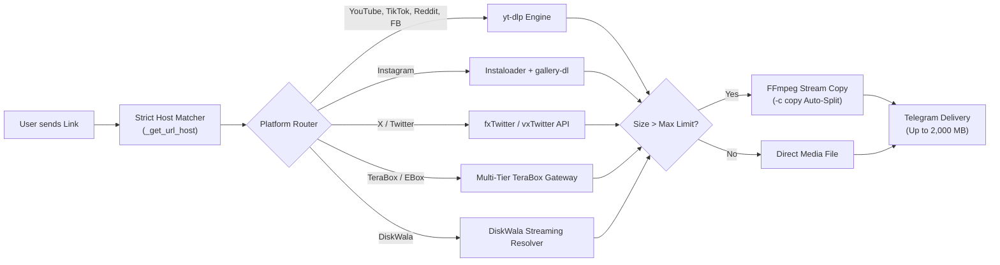

<div align="center">

# 📥 Universal Media Downloader Bot

### An open-source, high-performance Telegram bot for downloading media, full videos up to 2 GB, and extracting studio MP3 audio in 100% original quality.

[](CHANGELOG.md)
[](LICENSE)
[](https://www.python.org/)
[](https://core.telegram.org/bots/api)
[](test_downloader.py)
[](https://github.com/yt-dlp/yt-dlp)
[](Dockerfile)
[](CHANGELOG.md)

[Live Bot Demo](https://t.me/UniversalMediaSaverBot) • [Changelog](CHANGELOG.md) • [Report Bug](https://github.com/rahilanw4r/universal-media-downloader-bot/issues) • [Developer Support](https://t.me/RahilAnw4r)

</div>

---

## 🌟 Supported Platforms

| Platform | Supported Formats | Highlights |
|---|---|---|
| 🎥 **YouTube** | Shorts, Full Videos, Live Recordings | 1080p, 720p, 480p, 360p, 192k MP3 audio |
| 📸 **Instagram** | Reels, Posts, Stories, Carousels | Multi-item albums, audio extraction, high-res |
| 📦 **TeraBox / EBox** | Shared files & videos (`terabox.com`, `1024tera.com`, `teraboxapp.com`, `freeterabox.com`, etc.) | Direct link resolution & multi-tier upstream fallback |
| 💾 **DiskWala** | Shared files & videos (`diskwala.com`, `diskwala.fun`, `/app`, `/s`, `/c`) | Fast direct streaming & zero-loss auto-splitting |
| 🐦 **X (Twitter)** | Videos, Clips, Animated GIFs | Best available stream via high-speed direct API |
| 🎵 **TikTok** | Videos & Sounds | Clean watermark-free HD MP4 |
| 📌 **Pinterest** | Video Pins, Idea Pins, High-Res Clips | Clean direct video download & image fallback |
| 🤖 **Reddit** | Videos with Audio | Auto-merges video and audio streams seamlessly |
| 📘 **Facebook** | Reels, Stories, Public Watch Videos | Fast HD delivery |
| 🌐 **1,000+ Others** | Vimeo, Dailymotion, Twitch Clips, SoundCloud, etc. | Powered by updated `yt-dlp` extraction engine |

---

## ✨ Key Features

- **🚀 2,000 MB (2 GB) File Delivery:** Connects to Telegram's official Local Bot API server (`telegram-bot-api`) to bypass the standard 50 MB bot upload limit and send videos up to **2 GB (2,000 MB)**.
- **💎 100% Original Quality (Lossless Delivery):** Media files are preserved in their exact native resolution and bitrate without lossy re-encoding or forced downscaling.
- **✂️ Zero-Loss Video Auto-Splitting:** When a video exceeds Telegram's size ceiling (50 MB cloud or 2,000 MB local), it is automatically sliced into sequential parts (`Part 1/N`, `Part 2/N`) using FFmpeg stream copying (`-c copy`) in 1–2 seconds with **zero visual or audio degradation**.
- **🎛️ Interactive Quality Picker:** Automatically probes video streams and presents instant quality selection buttons:
  - `[ 💎 1080p FHD ]` `[ 📺 720p HD ]` `[ 📱 480p SD ]` `[ ⚡ 360p Data Saver ]`
- **⚡ Instant Zero-Click Mode:** Send `/mode` to switch between **Instant Mode** (fastest auto-download with 0 extra clicks) and **Quality Picker** (interactive resolution buttons).
- **🛑 Instant Task Cancellation:** Cancel running downloads or dismiss active quality picker sessions immediately using `/stop` or `/cancel`.
- **📊 Real-Time Animated Progress Bar:** Live status updates right on Telegram showing percentage, transfer speed, bytes downloaded, and estimated time of arrival (ETA):
  ```text
  ⏳ Downloading from YouTube...
  [████████░░░░] 67%
  ⚡ Speed: 5.4 MB/s | Size: 16.2 MB / 24.1 MB
  ⏱️ ETA: 1s
  ```
- **🎵 Studio MP3 Extraction:** Converts any video into high-fidelity 192kbps MP3 audio with the **original video thumbnail embedded as Album Cover Art** for Telegram's native audio player.
- **👥 Group Chat Ready:** Add the bot to any Telegram group chat with the 1-tap `[➕ Add Me to Your Group]` button in `/start`. The bot automatically processes and delivers media links shared by group members.
- **🔒 Private White-Label & Whitelist:** Restrict bot usage to specific user IDs (`ALLOWED_TELEGRAM_USER_IDS`) or enforce mandatory Telegram channel subscriptions (`FORCE_SUB_CHANNEL`).
- **📈 Built-in Analytics & Admin Tools:** Real-time diagnostics, `/stats` tracking, `/clean` cache purges, live `/cookies` reloads, and `/broadcast` announcements.

---

## 🏗️ Architecture & Processing Flow



---

## ⌨️ Bot Commands Reference

### 📥 General Commands

| Command | Aliases | Description |
|---|---|---|
| `/start` | — | Welcome greeting, supported platforms overview, and quick action buttons |
| `/mode` | — | Toggle between **⚡ Instant Mode** (auto-download) and **🔘 Quality Picker** |
| `/mp3 <url>` | `/audio` | Extract studio-grade 192kbps MP3 audio with embedded album cover art |
| `/stop` | `/cancel` | Cancel active downloads, abort long tasks, and clear pending session menus |
| `/ping` | — | Check server response latency, uptime, and system operational health |
| `/help` | — | Open the interactive user manual and instructions guide |
| `/about` | — | Display bot architecture, engine versions, and uptime |
| `/changelog` | — | View version release notes and recent feature updates |
| `/contact` | `/admin` | Contact the developer and admin directly ([@RahilAnw4r](https://t.me/RahilAnw4r)) |

### 👑 Admin Commands

| Command | Aliases | Description |
|---|---|---|
| `/stats` | `/analytics` | View user metrics, 24h & 7d active users, and platform usage breakdown |
| `/cookies` | `/cookie` | Check cookie status for YouTube, Instagram, and TeraBox; upload `cookies.txt` directly in chat |
| `/clean` | `/clearcache` | Immediately purge old temporary downloads and free up disk space |
| `/broadcast <msg>` | — | Broadcast an announcement message to all registered bot users |

---

## ⚙️ Configuration Reference (`.env`)

Create a `.env` file in the project root (or copy from `.env.example`):

```bash
cp .env.example .env
```

| Environment Variable | Default | Description |
|---|---|---|
| `TELEGRAM_BOT_TOKEN` | *Required* | Telegram Bot API token obtained from [@BotFather](https://t.me/BotFather) |
| `LOCAL_BOT_API_URL` | *Empty* | URL of self-hosted Bot API server (e.g. `http://localhost:8081`) to unlock **2 GB** uploads |
| `LOCAL_BOT_API_LOCAL_MODE` | `false` | Set to `true` when the bot and local Bot API share local disk for zero-copy file uploads |
| `MAX_FILE_SIZE_MB` | `2000` (Local) / `50` (Cloud) | Maximum file size in megabytes before auto-splitting or rejection |
| `AUTO_SPLIT_OVERSIZED_VIDEOS` | `true` | Automatically split videos exceeding size limit with zero quality loss |
| `ENABLE_VIDEO_COMPRESSION` | `false` | Enable lossy compression fallback (Default: `false` for 100% original quality) |
| `FORCE_SUB_CHANNEL` | `@Bootscreen` | Enforce required channel membership gate (leave blank to disable) |
| `ALLOWED_TELEGRAM_USER_IDS` | *Empty* | Whitelist specific Telegram user IDs (comma-separated). Blank allows everyone |
| `ADMIN_ID` | *Empty* | Telegram user ID of the primary administrator for privileged commands |
| `DISKWALA_API_KEY` | *Empty* | Optional API key for third-party Diskwala extraction endpoints |
| `DISKWALA_API_URL` | *Empty* | Optional custom Diskwala extractor/proxy endpoint |
| `TERABOX_COOKIE` | *Empty* | Optional TeraBox session cookie (`ndus`) for private or high-rate links |
| `COOKIES_CONTENT` | *Empty* | Raw Netscape cookie content or Base64 string for platform authentication |

---

## 🚀 Deployment Options

### 1. Local Setup (Linux / macOS / Windows)

```bash
# Clone the repository
git clone https://github.com/rahilanw4r/universal-media-downloader-bot.git
cd universal-media-downloader-bot

# Install dependencies
pip install -r requirements.txt

# Configure environment
cp .env.example .env
nano .env  # Enter your TELEGRAM_BOT_TOKEN

# Start the bot
python bot.py
```

---

### 2. Linux VPS Production Setup (`systemd` Service)

To keep the bot running 24/7 in the background with auto-restart on system reboot:

1. Create a service file:
```bash
sudo nano /etc/systemd/system/universal-bot.service
```

2. Add the following configuration (adjust user and path):
```ini
[Unit]
Description=Universal Media Downloader Telegram Bot
After=network.target

[Service]
Type=simple
User=ubuntu
WorkingDirectory=/home/ubuntu/universal-media-downloader-bot
ExecStart=/usr/bin/python3 bot.py
Restart=always
RestartSec=5
EnvironmentFile=/home/ubuntu/universal-media-downloader-bot/.env

[Install]
WantedBy=multi-user.target
```

3. Enable and start the service:
```bash
sudo systemctl daemon-reload
sudo systemctl enable universal-bot
sudo systemctl start universal-bot
sudo systemctl status universal-bot
```

---

### 3. Docker Deployment (With 2 GB Local Bot API)

Run both the bot and Telegram's Local Bot API Server with a single command:

```bash
# Set your TELEGRAM_API_ID, TELEGRAM_API_HASH, and TELEGRAM_BOT_TOKEN in .env
docker compose up -d
```

To view live logs:
```bash
docker compose logs -f
```

---

### 4. Deploy on Render

1. Create a new **Web Service** on [Render Dashboard](https://dashboard.render.com).
2. Connect your GitHub repository.
3. Configure settings:
   - **Environment:** `Python`
   - **Build Command:** `pip install --upgrade pip && pip install -r requirements.txt`
   - **Start Command:** `python bot.py`
4. Add Environment Variable:
   - `TELEGRAM_BOT_TOKEN` = `your_telegram_bot_token`
5. Click **Deploy**! (The bot includes a built-in health server that automatically binds to `$PORT` to satisfy Render's health checks).

---

### 5. Deploy on Koyeb

1. Create a new service on [Koyeb](https://www.koyeb.com/).
2. Select **GitHub** and choose this repository.
3. Set Environment Variable `TELEGRAM_BOT_TOKEN`.
4. Deploy!

---

## 🧪 Running Automated Tests

Run the full automated test suite (verifying all domain classifiers, link parsers, and extractors):

```bash
python3 -m unittest discover
```

All 20 test suites should finish with `OK`.

---

## 💬 Community & Support

- **Community Discussion:** [Join @BootScreenCommunity](https://t.me/BootScreenCommunity)
- **Announcements & Updates:** [Join @Bootscreen](https://t.me/Bootscreen)
- **Direct Developer Contact:** [Rahil Anwar (@RahilAnw4r)](https://t.me/RahilAnw4r)

---

## 📄 License

This project is licensed under the **MIT License** — see the [LICENSE](LICENSE) file for details.

<div align="center">

⭐ **Star this repository if you find it helpful!**

</div>
