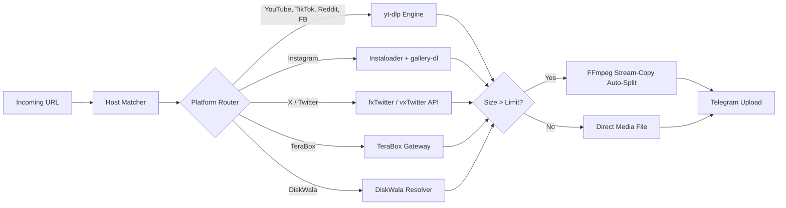

# Universal Media Downloader Bot

A modular Telegram bot for downloading video, photo, audio, and album media from Instagram, YouTube, X (Twitter), TikTok, TeraBox, DiskWala, Reddit, Pinterest, and 1,000+ sites supported by `yt-dlp`.

[](LICENSE)
[](https://www.python.org/)
[](test_downloader.py)

---

## Features

- **Direct Downloads:** Send any media link; the bot immediately downloads and delivers the file in its highest native resolution and bitrate without lossy re-encoding.
- **Large File Support (up to 2 GB):** Integrates with self-hosted `telegram-bot-api` to bypass Telegram's default 50 MB cloud bot limit.
- **Stream-Copy Auto-Splitting:** Videos exceeding file size limits are automatically split into sequential parts using FFmpeg stream copy (`-c copy`) without re-encoding or quality loss.
- **Audio Extraction:** Convert any video to 192 kbps MP3 with embedded thumbnail album art via `/mp3 <url>` or direct button prompt.
- **Group Chat Integration:** Add the bot to groups; it automatically processes media links sent by chat members.
- **Task Management:** Real-time progress updates with cancel support via `/stop` or `/cancel`.
- **Platform Authentication:** Support for custom cookies (`cookies.txt` hot-reload) and API keys for platforms requiring credentials (e.g. YouTube, TeraBox, DiskWala).

---

## Supported Platforms

| Platform | Formats / Content Types | Notes |
|---|---|---|
| YouTube | Videos, Shorts, Streams | Native resolution up to 4K, 192k MP3 audio |
| Instagram | Reels, Posts, Stories, Carousels | Multi-item albums, video clips |
| X (Twitter) | Videos, Clips, GIFs | Direct API extraction |
| TikTok | Videos, Sounds | Clean video without watermark |
| TeraBox | Shared files and videos (`terabox.app`, `1024tera.com`, etc.) | Direct stream resolution with session cookie (`NDUS`) support |
| DiskWala | Shared files and links (`diskwala.com`, `/app`, `/s`, `/c`) | Direct streaming with private resolver / API support |
| Pinterest | Video pins, idea pins, image pins | Direct video stream or full-resolution image fallback |
| Reddit | Videos with audio | Automatic video/audio stream merging |
| Facebook | Reels, public watch videos | Direct MP4 stream |
| 1,000+ Others | Vimeo, Twitch clips, SoundCloud, Dailymotion | Handled via `yt-dlp` |

---

## Architecture



---

## Commands

### User Commands

| Command | Alias | Description |
|---|---|---|
| `/start` | — | Start the bot and view quick options |
| `/mp3 <url>` | `/audio` | Extract 192 kbps MP3 with embedded thumbnail |
| `/stop` | `/cancel` | Cancel active downloads and clear current sessions |
| `/ping` | — | Check server response latency and health |
| `/stats` | `/analytics` | View download metrics and system uptime |
| `/help` | — | Show the user guide and instructions |
| `/about` | — | View bot engine specifications and version |
| `/contact` | `/admin` | Contact bot administrator |

### Admin Commands

| Command | Alias | Description |
|---|---|---|
| `/stats` | `/analytics` | View complete metrics: active users, total downloads, platform breakdown |
| `/changelog` | — | View latest detailed release notes and group announcement format |
| `/cookies` | `/cookie` | Check cookie status; upload updated `cookies.txt` directly in chat |
| `/clean` | `/clearcache` | Delete temporary files from download directory |
| `/broadcast <msg>` | — | Send announcement message to all registered bot users |

---

## Configuration

Create a `.env` file in the project root:

```bash
cp .env.example .env
```

| Variable | Default | Description |
|---|---|---|
| `TELEGRAM_BOT_TOKEN` | *Required* | Bot token obtained from [@BotFather](https://t.me/BotFather) |
| `LOCAL_BOT_API_URL` | *Empty* | Base URL of self-hosted Bot API server (e.g. `http://localhost:8081`) to unlock 2 GB uploads |
| `LOCAL_BOT_API_LOCAL_MODE` | `false` | Enable local zero-copy file uploads when bot and Bot API share the filesystem |
| `MAX_FILE_SIZE_MB` | `2000` (Local) / `50` (Cloud) | Maximum upload file size before splitting or rejecting |
| `AUTO_SPLIT_OVERSIZED_VIDEOS` | `true` | Automatically split videos exceeding size limit with FFmpeg stream copy |
| `FORCE_SUB_CHANNEL` | `@Bootscreen` | Optional required Telegram channel subscription gate |
| `ALLOWED_TELEGRAM_USER_IDS` | *Empty* | Comma-separated list of allowed user IDs (leave empty for public access) |
| `ADMIN_ID` | *Empty* | Telegram user ID of bot administrator |
| `TERABOX_COOKIE` | *Empty* | TeraBox `ndus` session cookie for authenticated file downloads |
| `DISKWALA_API_KEY` | *Empty* | Optional API key for third-party DiskWala extraction |
| `DISKWALA_API_URL` | *Empty* | Optional custom DiskWala extractor endpoint |
| `COOKIES_CONTENT` | *Empty* | Netscape cookie content or Base64 string for YouTube/Instagram authentication |
| `PROMO_CHANNELS_ENABLED` | `true` | Enable non-forced channel recommendation buttons on media outputs |
| `MOD_APK_CHANNEL` | `ModRepository` | Telegram username for Mod APK channel recommendation |
| `WALLPAPER_CHANNEL` | `WallpapersRepository` | Telegram username for Wallpapers channel recommendation |

---

## Deployment

### 1. Local Setup

```bash
git clone https://github.com/rahilanw4r/universal-media-downloader-bot.git
cd universal-media-downloader-bot

pip install -r requirements.txt
cp .env.example .env
# Edit .env with your TELEGRAM_BOT_TOKEN

python bot.py
```

### 2. Linux Service (`systemd`)

Create `/etc/systemd/system/universal-bot.service`:

```ini
[Unit]
Description=Universal Media Downloader Telegram Bot
After=network.target

[Service]
Type=simple
User=ubuntu
WorkingDirectory=/home/ubuntu/universal-media-downloader-bot
ExecStart=/usr/bin/python3 bot.py
Restart=always
RestartSec=5
EnvironmentFile=/home/ubuntu/universal-media-downloader-bot/.env

[Install]
WantedBy=multi-user.target
```

Enable and start:

```bash
sudo systemctl daemon-reload
sudo systemctl enable --now universal-bot
```

### 3. Docker (with 2 GB Local Bot API)

```bash
# Configure TELEGRAM_API_ID, TELEGRAM_API_HASH, and TELEGRAM_BOT_TOKEN in .env
docker compose up -d
docker compose logs -f
```

### 4. Cloud Hosts (Render / Koyeb)

- **Render**: Connect repository as a Web Service. The bot includes an HTTP server binding to `$PORT` to satisfy Render's health checks. Set `TELEGRAM_BOT_TOKEN` in the dashboard.
- **Koyeb**: Connect repository, configure `TELEGRAM_BOT_TOKEN`, and deploy.

---

## Testing

Run unit tests:

```bash
python3 -m unittest discover
```

---

## License

This project is licensed under the MIT License. See [LICENSE](LICENSE) for details.
