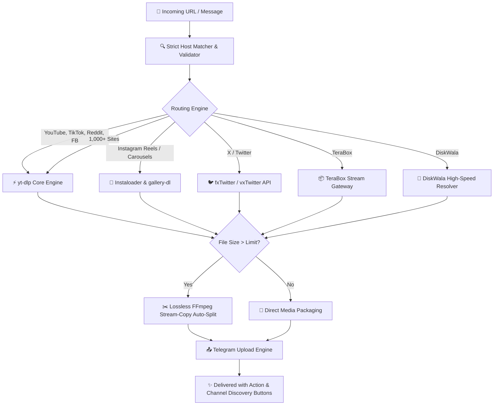

<div align="center">

# ⚡ Universal Media Downloader Bot

**A high-performance, modular Telegram bot for downloading media in 100% full original quality from 1,000+ platforms.**

[](CHANGELOG.md)
[](https://www.python.org/)
[](LICENSE)
[](https://github.com/python-telegram-bot/python-telegram-bot)
[](test_downloader.py)
[](docker-compose.yml)

<p align="center">
  <a href="#-key-features">Key Features</a> •
  <a href="#-supported-platforms">Supported Platforms</a> •
  <a href="#-architecture">Architecture</a> •
  <a href="#-quick-start">Quick Start</a> •
  <a href="#-configuration">Configuration</a> •
  <a href="#-commands">Commands</a> •
  <a href="#-production-deployment">Deployment</a> •
  <a href="#-license">License</a>
</p>

</div>

---

## 🌟 Overview

**Universal Media Downloader** is an enterprise-grade Telegram bot engineered for ultra-fast, lossless media downloads. Whether extracting 4K videos from YouTube, multi-slide carousels from Instagram, direct streams from TeraBox and DiskWala, or watermark-free TikTok clips, the bot preserves **100% original quality** without unnecessary re-encoding or artificial quality downscaling.

Equipped with support for self-hosted `telegram-bot-api`, it shatters the default 50 MB cloud limit to deliver files up to **2,000 MB (2 GB)** with seamless FFmpeg stream-copy auto-splitting for oversized media.

```
┌────────────────────────────────────────────────────────┐
│  🎬 Video Title Here                                   │
│                                                        │
│  ▫️ Platform: YouTube                                  │
│  ▫️ Size: 48.2 MB                                      │
│  ▫️ Duration: 05:32                                    │
├────────────────────────────────────────────────────────┤
│  [ 🎵 Extract MP3 Audio ]                              │
│  [ 📱 Mod APKs ]  [ 🖼️ Wallpapers ]                   │
└────────────────────────────────────────────────────────┘
```

---

## ✨ Key Features

| Feature | Description |
|---|---|
| 💎 **100% Full Original Quality** | Media is always fetched at highest available native resolution and bitrate without lossy transcoding. |
| 🚀 **Up to 2 GB File Delivery** | Seamless integration with self-hosted `telegram-bot-api` unlocks 2,000 MB file uploads. |
| ✂️ **Lossless Auto-Splitting** | Videos exceeding upload limits are automatically sliced into sequential parts using FFmpeg stream-copy (`-c copy`) in seconds. |
| 🎵 **Instant MP3 Extraction** | Convert any video link into a pristine 192 kbps MP3 with embedded album artwork via `/mp3` or inline button. |
| 👥 **Native Group Chat Support** | Add to any Telegram group; automatically monitors and delivers media links shared by members. |
| 🔄 **Multi-Tier Resolvers** | Intelligent failover across dedicated APIs, `gallery-dl`, `instaloader`, and `yt-dlp` guarantees industry-leading success rates. |
| 🛡️ **Privacy & Security First** | Zero logging of sensitive user data, private tokens, or credentials. Cookies can be securely reloaded on the fly. |
| ⚡ **Live Download Progress** | Real-time progress bars with download speed, ETA, and instant task cancellation via `/stop`. |

---

## 🌐 Supported Platforms

| Platform | Supported Formats | Engine / Extractor | Highlights |
|---|---|---|---|
| **YouTube** | Videos, Shorts, Livestreams, Audio | `yt-dlp` | Full native quality up to 4K / 60fps; 192k MP3 audio |
| **Instagram** | Reels, Posts, Stories, Multi-item Carousels | `instaloader` + `gallery-dl` | High-res carousel albums, original audio track retention |
| **TikTok** | Videos, Audio, Slideshows | `yt-dlp` | 100% clean video stream with no watermark |
| **X (Twitter)** | Videos, Clips, GIFs | `fxTwitter` / `vxTwitter` API | Ultra-fast direct API extraction |
| **TeraBox** | Shared files, video links (`terabox.app`, `1024tera.com`, etc.) | Direct Stream Gateway | Direct download stream resolution with `NDUS` cookie support |
| **DiskWala** | Shared files & streams (`diskwala.com`, `/app`, `/s`, `/c`) | Custom Resolver API | High-speed direct streaming and multi-part handling |
| **Reddit** | Videos, Clips, Gifs, Audio (`v.redd.it`) | Native API + `yt-dlp` | Automatic DASH video + audio stream synchronization |
| **Pinterest** | Video pins, image pins, idea pins | `pinterest-downloader` + Scraper | Highest resolution video extraction with image fallback |
| **Facebook** | Reels, public watch videos, clips | `yt-dlp` | Direct HD MP4 video streams |
| **1,000+ Others** | Vimeo, Twitch clips, SoundCloud, Dailymotion, etc. | `yt-dlp` | Universal compatibility across all yt-dlp supported sites |

---

## 🏗️ Architecture



---

## ⚡ Quick Start

### Prerequisites
* **Python 3.10+**
* **FFmpeg** installed on your system PATH (`sudo apt install ffmpeg` on Ubuntu/Debian)
* A Telegram Bot Token from [@BotFather](https://t.me/BotFather)

### 1. Clone & Install

```bash
# Clone the repository
git clone https://github.com/rahilanw4r/universal-media-downloader-bot.git
cd universal-media-downloader-bot

# Set up a virtual environment (recommended)
python3 -m venv venv
source venv/bin/activate

# Install dependencies
pip install -r requirements.txt
```

### 2. Configure Environment

```bash
# Copy example configuration
cp .env.example .env

# Edit .env with your credentials
nano .env
```

Set your bot token in `.env`:
```env
TELEGRAM_BOT_TOKEN=123456789:ABCDefGhIJKlmNoPQRsTUVwxyZ
```

### 3. Run the Bot

```bash
python bot.py
```

---

## ⚙️ Configuration Reference

All settings are managed via environment variables in `.env`:

| Variable | Default | Description |
|---|---|---|
| `TELEGRAM_BOT_TOKEN` | *Required* | Telegram Bot API token obtained from [@BotFather](https://t.me/BotFather) |
| `LOCAL_BOT_API_URL` | *Empty* | Self-hosted Bot API endpoint (e.g. `http://localhost:8081`) to unlock 2,000 MB uploads |
| `LOCAL_BOT_API_LOCAL_MODE` | `false` | Enable zero-copy uploads when bot and Bot API server share filesystem access |
| `MAX_FILE_SIZE_MB` | `2000` / `50` | Maximum file size limit before splitting or rejecting (MB) |
| `AUTO_SPLIT_OVERSIZED_VIDEOS` | `true` | Automatically split files exceeding `MAX_FILE_SIZE_MB` with FFmpeg stream-copy |
| `ALLOWED_TELEGRAM_USER_IDS` | *Empty* | Comma-separated list of Telegram user IDs for private bots (empty = public access) |
| `ADMIN_ID` | *Empty* | Telegram user ID of bot administrator |
| `TERABOX_COOKIE` | *Empty* | TeraBox `ndus` session cookie for authenticated high-speed downloads |
| `DISKWALA_API_KEY` | *Empty* | Optional API key for third-party DiskWala extraction portals |
| `DISKWALA_API_URL` | *Empty* | Optional custom DiskWala resolver endpoint |
| `COOKIES_CONTENT` | *Empty* | Netscape format or Base64 cookies string for YouTube/Instagram authentication |
| `PROMO_CHANNELS_ENABLED` | `true` | Enable non-intrusive interactive recommendation buttons below media deliveries |
| `MOD_APK_CHANNEL` | `ModRepository` | Target channel username for Mod APK recommendation button |
| `WALLPAPER_CHANNEL` | `WallpapersRepository` | Target channel username for Wallpapers recommendation button |

---

## 🤖 Commands

### User Commands

| Command | Shortcut | Description |
|---|---|---|
| `/start` | — | Display bot welcome menu, status, and quick-action shortcuts |
| `/mp3 <url>` | `/audio` | Extract audio as 192 kbps MP3 with embedded thumbnail album art |
| `/stop` | `/cancel` | Cancel active downloads and clear current user sessions |
| `/ping` | — | Check server response latency, API status, and system health |
| `/stats` | `/analytics` | View personal download metrics and system uptime |
| `/help` | — | Display comprehensive instruction manual and supported platforms |
| `/about` | — | View bot engine specifications, version, and architecture |
| `/admin` | `/contact` | Contact bot administrator directly |

### Administrator Commands

| Command | Shortcut | Description |
|---|---|---|
| `/stats` | `/analytics` | View full platform metrics: active users, total downloads, breakdown |
| `/cookies` | `/cookie` | Check cookie status and upload updated `cookies.txt` directly in chat |
| `/clean` | `/clearcache` | Safely purge all temporary files from the download directory |
| `/broadcast <msg>` | — | Broadcast announcement message to all registered bot users |
| `/changelog` | — | View latest detailed release notes |

---

## 🚀 Production Deployment

### Option 1: Docker Compose (with 2 GB Local Bot API)

This is the recommended production setup. It runs the bot alongside a local Telegram Bot API container to enable **2 GB uploads**.

1. Create and configure `.env` with your `TELEGRAM_API_ID`, `TELEGRAM_API_HASH`, and `TELEGRAM_BOT_TOKEN`.
2. Launch the stack:
   ```bash
   docker compose up -d
   ```
3. Inspect logs:
   ```bash
   docker compose logs -f
   ```

### Option 2: Linux System Service (`systemd`)

Create `/etc/systemd/system/universal-bot.service`:

```ini
[Unit]
Description=Universal Media Downloader Telegram Bot
After=network.target

[Service]
Type=simple
User=ubuntu
WorkingDirectory=/home/ubuntu/universal-media-downloader-bot
ExecStart=/usr/bin/python3 bot.py
Restart=always
RestartSec=5
EnvironmentFile=/home/ubuntu/universal-media-downloader-bot/.env

[Install]
WantedBy=multi-user.target
```

Enable and start:
```bash
sudo systemctl daemon-reload
sudo systemctl enable --now universal-bot
sudo systemctl status universal-bot
```

### Option 3: Cloud Platforms (Render / Koyeb)

* **Render:** Connect the repository as a Web Service. The bot includes an automatic lightweight HTTP server binding to `$PORT` to satisfy health checks. Add `TELEGRAM_BOT_TOKEN` in the environment variables dashboard.
* **Koyeb:** Connect the repository, configure `TELEGRAM_BOT_TOKEN`, and deploy with default Python buildpack.

---

## 🧪 Testing

The test suite covers URL extraction, platform detection, edge cases, video auto-splitting, and keyboard builders:

```bash
python3 -m unittest discover
```

```text
Ran 36 tests in 8.951s
OK (skipped=2)
```

---

## 📂 Project Structure

```
universal-media-downloader-bot/
├── bot.py                  # Main Telegram bot runtime, handlers & delivery logic
├── downloader.py           # Core media download engine & platform extractors
├── config.py               # Centralized configuration & environment loader
├── analytics.py            # Download metrics, telemetry & user persistence
├── test_downloader.py      # Automated unit test suite
├── requirements.txt        # Python dependency manifest
├── Dockerfile              # Container image specification
├── docker-compose.yml      # Multi-container stack (Bot + 2 GB Bot API)
├── render.yaml             # Render cloud deployment blueprint
├── .env.example            # Environment variables template
├── CHANGELOG.md            # Release version history
└── README.md               # Documentation & quick start guide
```

---

## 📄 License

Distributed under the **MIT License**. See [`LICENSE`](LICENSE) for more information.

---

<div align="center">

**Built with ❤️ by [Rahil Anwar](https://github.com/rahilanw4r)**

Join our discussion & updates community: **[@BootScreenCommunity](https://t.me/BootScreenCommunity)**

</div>
